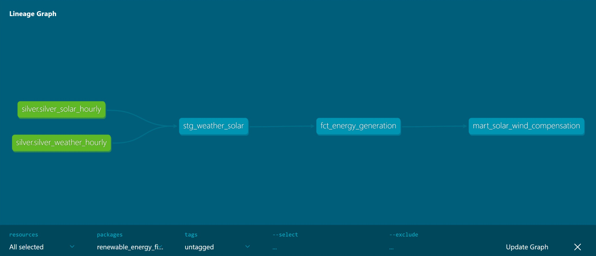

# dbt Transformation Guide

> How the Silver Layer becomes the Golden Layer, and how to run, test, and document it.

## 1. Overview

```text
BigQuery silver_trusted_dataset.stg_weather_solar   (table, written by Airflow MERGE)
        │  source('silver', 'stg_weather_solar')
        ▼
gold_analytical_mart.stg_weather_solar              (view: rename, cast, unit conversion)
        │  ref()
        ▼
gold_analytical_mart.fct_energy_generation          (incremental fact, hourly)
        │  ref()
        ▼
gold_analytical_mart.mart_solar_wind_compensation   (daily answer to the business question)
```

The staging view lives in the Gold dataset on purpose: **it** avoids a name clash with the Silver table and keeps the dbt service account read-only on Silver.

## 2. Setup

| Piece | Where | Notes |
| ----- | ---- | ---- |
| dbt-bigquery 1.11.1 | `/home/airflow/dbt-venv` (Dockerfile) | Isolated venv, no conflicts with Airflow's pinned dependencies |
| Project | `dbt/` mounted at `/airflow/dbt` | Mounted in webserver, scheduler **and worker** |
| Auth | `profiles.yml`, `method: oauth` | Uses Application Default Credentials. Locally via `GOOGLE_APPLICATION_CREDENTIALS`; in GitHub Actions via WIF. No secrets in the repo |
| Packages | `packages.yml` | `dbt_utils` (surrogate key, range and combination tests) |

Environment variables read by `profiles.yml`:
* `GOOGLE_CLOUD_PROJECT` (already set in `docker-compose.yml`)
* `DBT_BQ_DATASET` (default `gold_analytical_mart`)
* `BQ_LOCATION` (default `us-central1`)

## 3. Source contract (Silver -> staging)

`stg_weather_solar.sql` expects these Silver columns from `silver_weather_hourly` and `silver_solar_hourly`. If yours differ, edit only the `typed` CTE.

| Silver column | Staging column | Conversion |
| --- | --- | --- |
| `observed_at` | `observation_at` | cast to TIMESTAMP (UTC) |
| (derived) | `observation_date`, <br>`observation_hour_local` | converted to local timezone via `var("timezone")` |
| `city_id` | `station_id`, `city` | cast to STRING |
| (null) | `latitude`, `longitude` | explicitly cast to NULL |
| `temperature_2m_c` | `temperature_c` | cast to FLOAT64 (°C) |
| `cloud_cover_pct` | `cloud_cover_pct` | cast to FLOAT64 (%) |
| `global_irradiance_wm2` (solar) <br> *or* `shortwave_radiation_wm2` (weather) | `solar_radiation_wm2` | COALESCE and cast to FLOAT64 (W/m²) |
| `wind_speed_100m_kmh` | `wind_speed_100m_ms` | km/h ÷ 3.6 ➔ m/s |
| (null) | `pvgis_pv_power_kw` | explicitly cast to NULL |

## 4. Business Logic

### 4.1 Solar Generation

* If PVGIS power is present: use it (assumes PVGIS was queried for a 1 kWp system).
* Otherwise model it: `irradiance/1000 x performance_ratio x temperature_derating.`
* Cell temperature ≈ ambient + 0.025 × irradiance; derating = `1 − 0.004 × (T_cell − 25).`
* The column `solar_data_source` (`pvgis` / `modelled`) keeps this transparent.

### 4.2 Wind Generation

The APIs return wind speed, not power, so output is estimated with a generic offshore turbine power curve (macro `wind_capacity_factor`): cut-in 3 m/s, rated 12 m/s, cut-out 25 m/s, cubic ramp in between, evaluated on wind speed at 100 m.

### 4.3 Comparing Solar and Wind fairly

Both are expressed as capacity factors (0..1) and as kWh for a reference plant (1 MWp solar, one 5 MW turbine). All parameters are variables in `dbt_project.yml`.

### 4.4 "Does wind compensate when solar drops?"

`mart_solar_wind_compensation` works at daily grain per city (hourly data cannot answer this: solar is zero every night).

1. Baseline = trailing 30-day average, current day excluded.
2. Low-solar day = solar CF < 50% of its baseline.
3. Shortfall = baseline solar CF − solar CF. Surplus = wind CF − baseline wind CF (both floored at 0).
4. `is_wind_compensating` = low-solar day **and** surplus ≥ shortfall.

Flags are `NULL` until a city has 7 days of history. Backfill first, then read the results.

Summary query per city:
```sql
select
  city,
  countif(is_low_solar_day)                                   as low_solar_days,
  countif(is_wind_compensating)                               as compensated_days,
  safe_divide(countif(is_wind_compensating), countif(is_low_solar_day)) as compensation_rate,
  corr(solar_cf, wind_cf)                                     as solar_wind_correlation
from `gold_analytical_mart.mart_solar_wind_compensation`
where baseline_solar_cf is not null
group by city
order by compensation_rate desc;
```
A negative correlation means the two sources complement each other.

## 5. Incremental 

`fct_energy_generation` uses `insert_overwrite`: each run replaces whole date partitions for the last `incremental_lookback_days` (3). Re-running a day or backfilling never duplicates rows, which mirrors the `{{ ds }}`-based idempotency of the Bronze ingestion. Only touched partitions are billed. For a full rebuild: `dbt build --full-refresh`.

## 6. Tests

| Model | Tests |
| --- | --- |
| `stg_weather_solar` | `not_null` on keys and city, unique (`observation_at`, `station_id`), physical ranges (`temperature`, `cloud_cover`, `solar_radiation`, `wind_speed`) |
| `fct_energy_generation` | unique + `not_null` surrogate key, capacity factors in [0, 1], generation ≥ 0, `accepted_values` on `solar_data_source` |
| `mart_solar_wind_compensation` | unique (`city`, `observation_date`), `not_null` on keys, consistency rule: compensation implies low-solar day |

`dbt build` runs models and tests in dependency order, so a failing test blocks everything downstream.

## 7. Airflow Integration

Final task of the DAG: `dbt_run_and_test`(BashOperator), running `dbt deps`, `dbt build` and `dbt docs generate`.

```text
... >> load_bronze_to_silver_bq >> dbt_run_and_test
```

## 8. Running Manually

```bash
docker compose exec airflow-worker bash
cd /airflow/dbt
/home/airflow/dbt-venv/bin/dbt deps
/home/airflow/dbt-venv/bin/dbt debug            # validates profile + BigQuery connection
/home/airflow/dbt-venv/bin/dbt build
/home/airflow/dbt-venv/bin/dbt docs generate
```

## 9. Visual Documentation

```bash
docker compose exec -w /airflow/dbt airflow-worker \
  /home/airflow/dbt-venv/bin/dbt docs generate
```
To browse the documentation locally without configuring port publishing on the container:

1. Locate the generated dbt/target/index.html file in the VS Code file explorer.
2. Open it using the Live Server extension (served at http://127.0.0.1:5500) or open index.html directly in your browser.
3. Click the bottom-right circular green button to explore the interactive Lineage Graph.



## 10. FinOps notes

* `maximum_bytes_billed: 1 GB` in `profiles.yml` fails any runaway query before it is billed.
* The fact table is partitioned by date and clustered by `station_id`
* All models carry BigQuery labels (`project`, `layer`) for cost attribution in Billing exports.

## 11. Troubleshooting

| Symptom | Cause / fix |
| --- | --- |
| `Access Denied creating views/tables` | The dbt service account needs BigQuery Data Editor on `gold_analytical_mart`, Data Viewer on `silver_trusted_dataset`, and Job User on the project |
| `Not found: Dataset ... in location X` | `BQ_LOCATION` does not match the datasets' location |
| `Unrecognized name: <column> in staging` | Silver column names differ from source; edit the `typed` CTE in `stg_weather_solar.sql` |
| `accepted_values fails on city` | Align the list with `select distinct city from gold_analytical_mart.stg_weather_solar` or remove the test from `schema.yml` |
| `Wind values look 3.6x too large` | Open-Meteo was queried with `wind_speed_unit=ms`; remove the `/ 3.6` conversion in staging |
| `Permission errors writing target/ on Linux hosts` | `sudo chown -R 50000:0 dbt/` (Airflow container user) |
| `Compensation flags are all NULL` | Fewer than 7 days of history; backfill the DAG |

---

**Built by:** @camillefk  
**Created:** November 2026  
**Last Updated:** November 08, 2026